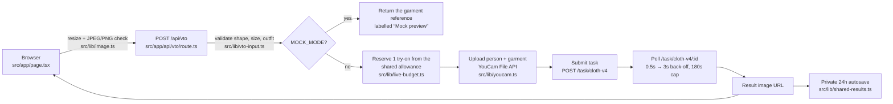

# How SangeetFit works

One page you should be able to explain end to end. Every box names the real file.

## The five steps

1. **Nothing happens until you press Generate.** Browsing, adding clothes, planning and printing never call YouCam. The fitting room needs the photo notice accepted, a full-body photo, and an explicit **Generate try-on** click (`src/app/page.tsx`).
2. **The browser shrinks photos first.** `src/lib/image.ts` caps the person photo near 2.4 MB and the garment near 1.4 MB, so the JSON request stays under 4,000,000 bytes.
3. **The server trusts nothing from the client.** `src/lib/vto-input.ts` checks the request shape, image types and sizes. A catalogue outfit can only use its own server-side reference image; a client file path is never accepted.
4. **Cloth V4 runs as an async task.** `src/app/api/vto/route.ts` reserves one try-on from a shared Redis allowance *before* uploading anything (`src/lib/live-budget.ts`). It then uploads both images through the YouCam File API, submits `cloth-v4`, and polls with back-off until `success` or `error`. A 429 stops immediately and is never retried automatically.
5. **Results are kept privately for 24 hours.** In live mode the photo, garment and result are stored in Redis with an 86,400-second expiry and a signed, per-visitor access token (`src/lib/shared-results.ts`). The person can delete them early. YouCam handles its own retention.

## Mock mode vs live mode

| | Mock (`MOCK_MODE=true`) | Live |
|---|---|---|
| YouCam called | Never | Yes, Cloth V4 |
| Result shown | The garment reference, labelled *“Mock preview — reference outfit, not a personal try-on”* | The generated image, labelled *“Generated result — live render from YouCam API”* |
| Missing API key | n/a | Fails closed with an error; never swaps in a mock image |

## The planner (no AI needed)

`src/components/WeddingWeekBoard.tsx` holds one outfit per event (Sangeet, Mehendi, Haldi, Wedding, Reception). It counts events planned, distinct owned outfits used, and planned rewears. **Print / Save as PDF** prints a text-only plan: no photos, no links.
