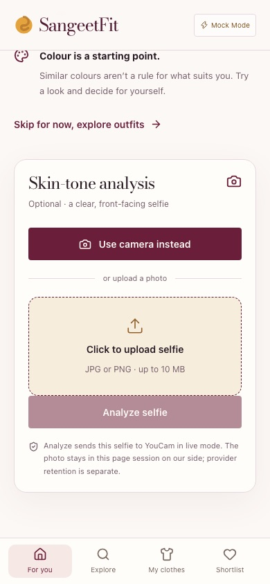
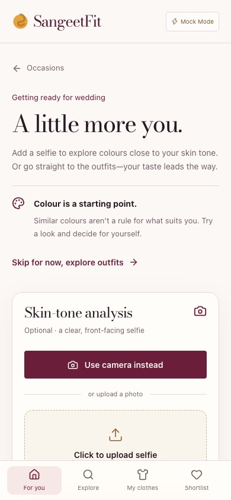
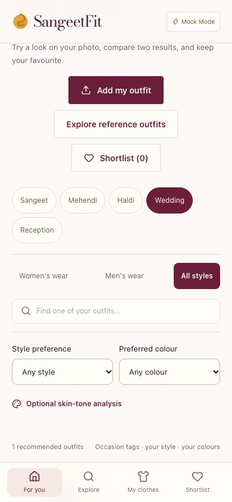
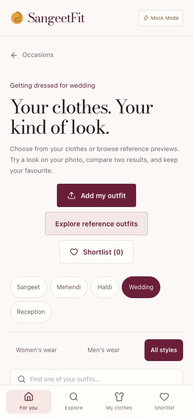
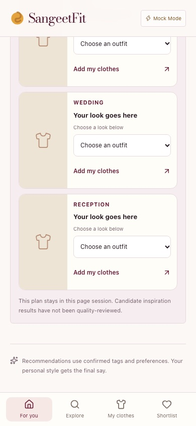
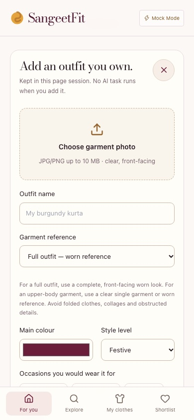
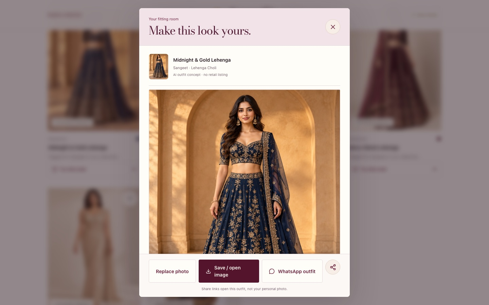
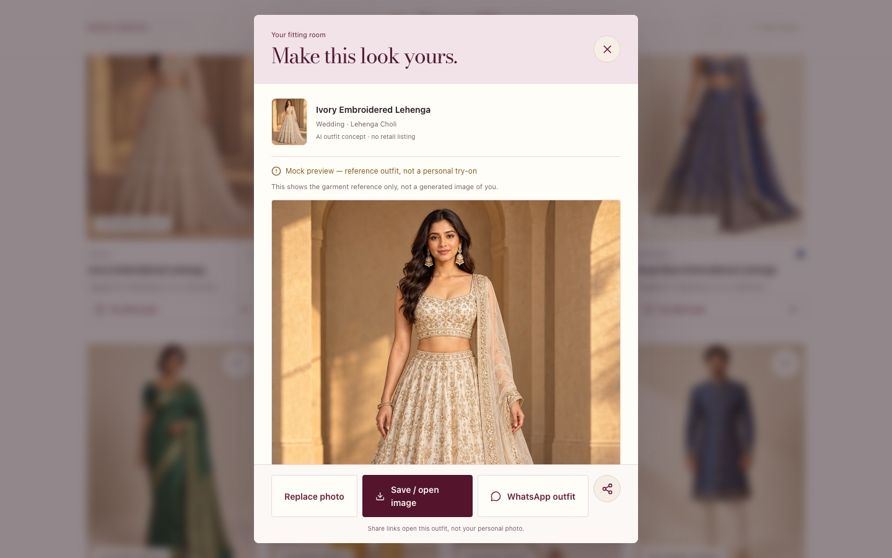
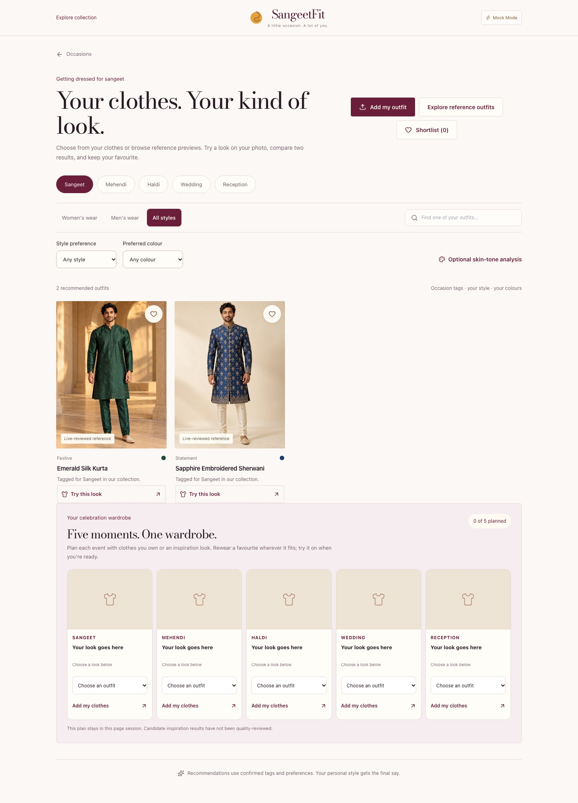
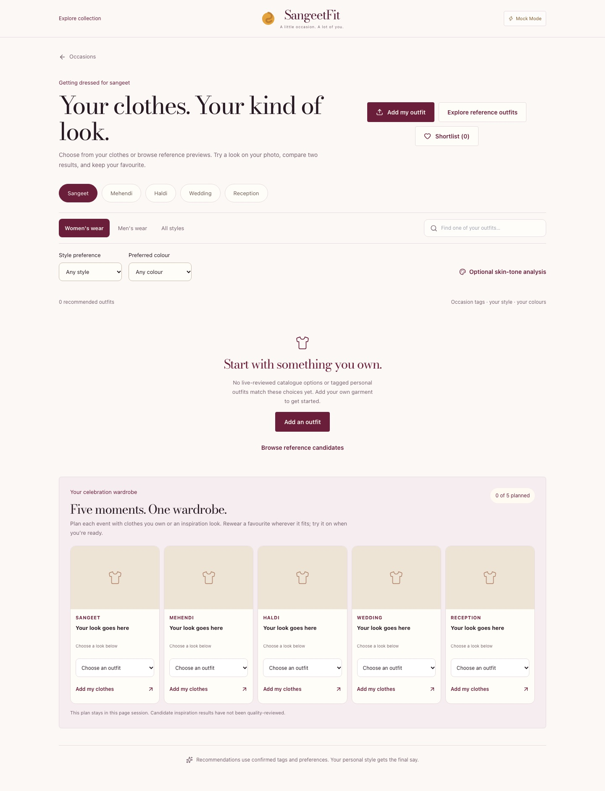

# UI-v2 playtest — 23 October 2026

Local **mock-only** checkpoint. No live YouCam task, paid operation, deployment, merge, private photo or secret was used. Browser emulation is not a physical-device test.

## Method

- Branch `UI-v2`; production build forced to `MOCK_MODE=true`, served at `127.0.0.1:3503`.
- Playwright Chromium at 1440×900, 390×844 and 320×844.
- Synthetic fixtures only: `public/garment_test/fullbody_mock.png` and `public/garment_test/kurta_set_hd.png`.
- Drove the real surfaces: occasion → optional selfie step → gallery → reference outfits → consent → full-body upload → explicit Generate → second look → compare → choose → own-garment add/generate → `/library`.
- Counted `/api/vto` requests through the browser. Browsing, upload, opening results and comparison submitted none; each explicit Generate submitted exactly one.

## Observed defects (before)

1. **Step transitions kept the previous scroll offset.** On a 375px phone, selecting Wedding while scrolled down opened the selfie step at `scrollY=243` with the new `h1` at `top=-76` under the 73px sticky navbar. Tapping “Skip for now” opened the gallery at the same offset with its heading hidden. On 390px the landing offsets were 263 and 243.
2. **“My clothes” from the bottom navigation appeared to do nothing.** From the gallery bottom, the inline wardrobe form mounted roughly 5,100px above the viewport; the visible screen did not change.
3. **The mock result label was below the fold.** The full-length result was 562×750 at desktop and 348×465 at 390px. The “Mock preview — reference outfit, not a personal try-on” status and its caveat rendered after the image, so neither was visible with the result at 1440×900 or 390×844.
4. **Remaining product gap, not changed here:** the default gallery contains only `live-reviewed` references, and both are menswear. For Sangeet the default shows two men’s looks; selecting Women’s wear shows zero cards, while six women’s Sangeet candidates exist behind “Explore reference outfits”. This is the deliberate reviewed-first rule, so this pass records it rather than changing the safety default.

## Fixes

- `src/app/page.tsx`: reset the window scroll on a step change; keep the wardrobe form in view with an anchor ref when it opens; move the result status and caveat above the result image.
- `src/app/globals.css`: spacing between the result caveat and image.
- `tests/ui-revamp.browser.test.mjs`: added assertions for step scroll reset, visible step heading, in-view wardrobe form from the bottom nav, and a visible mock label.

Re-measured after the fix: step scroll `0` at both phone widths; wardrobe form top `100px`; mock label at `y=237–272` inside the open dialog; exactly one request per explicit Generate; no page or console errors.

## Verification

- `TEST_PORT=3520 npm run verify` exited `0`: 14 offline suites, canonical TypeScript, lint (0 errors, 20 existing warnings), mock production build and 8 mock browser suites. Redis-backed budget assertions skipped locally because neither `redis-cli` nor `TEST_REDIS_CONTAINER` is available.
- `git diff --check` passed after documentation was added.
- Targeted Playwright runs at 1440/390/320 showed no horizontal overflow and no console errors.

## Before / after

Step 2 landing on a phone, before and after:

Gallery landing on a phone, before and after:

“My clothes” from the bottom of the gallery, before and after:

Mock result label, desktop before and after:

Remaining catalog gap on desktop (Sangeet, default and Women’s wear):

## Limitations

- Chromium emulation only; no physical phone, iOS Safari or camera test.
- Mock results are reference images, not personal try-ons; this run is not live-quality evidence.
- The independent `sf-reviewer` subagent is not available in this client, so no independent review was obtained for this checkpoint.
- The women’s default-browse gap and reviewed-vs-candidate default strategy remain open.
